# NYC Taxi Trip Duration Prediction | End-to-End ML Engineering

[](https://github.com/HassanHijaze/nyc-taxi-prediction-service/actions/workflows/ci.yml)

**From NYC TLC trip records to a monitored prediction API.** This project predicts yellow-taxi trip duration using only information available at pickup: origin zone, destination zone, and pickup time. It includes reproducible training, validation-based model selection, MLflow registration, safe FastAPI model reloads, CI, and Prometheus metrics.

**4.4415 min test RMSE** · **112.4 MiB model** · **120 ms p95 at 10 users** · **0% load-test failures**

*Python · scikit-learn · Optuna · MLflow / PostgreSQL · FastAPI · Docker Compose · Prometheus · Locust*

[Results](#results) · [Selection](#why-this-model) · [Architecture](#architecture) · [Data](#what-the-data-showed) · [Quick Start](#quick-start) · [API](#api) · [Quality & Benchmarks](#quality-and-benchmarks) · [Trade-offs](#decisions-and-limitations)

## Results

January 2025 NYC yellow-taxi trips, restricted to **1–60 minutes**, with a chronological split: **train Jan 1–20**, **validate Jan 21–25**, **test Jan 26–31**. RMSE is measured in minutes.

| Model | Validation RMSE | Test RMSE |
|---|---:|---:|
| Overall median | 9.9949 | 10.1225 |
| Zone-pair median | 5.4437 | 5.4237 |
| Random Forest baseline | 4.4771 | 4.4837 |
| **Selected RF · trial-1** | **4.4435** | **4.4415** |

The selected model reduces test RMSE by **18.1%** relative to the zone-pair median baseline and is **41.1% smaller** than the RF baseline, with slightly better accuracy. Sizes refer to serialized model artifacts, not Docker images or total deployment sizes.

### Feature ladder

Random Forests with the RF baseline's settings, fitted on the same training sample and scored on the same validation trips, adding features step by step: zone IDs only, then zone centers and straight-line distance, then all features (the RF baseline). Ladder runs are references, not selection candidates. Source: section 6 of [model_serving_selection.ipynb](notebooks/model_serving_selection.ipynb).

<!-- TODO: fill the TBD cells from the notebook output (section 6) after `uv run nyc-taxi train` and `uv run nyc-taxi select`. -->

| Model | Validation RMSE | Test RMSE | Model size (MiB) |
|---|---:|---:|---:|
| Overall median | TBD | TBD | – |
| Zone-pair median | TBD | TBD | – |
| ladder-zones | TBD | – | TBD |
| ladder-zones-location | TBD | – | TBD |
| rf-baseline | TBD | – | TBD |
| Best Optuna trial (TBD) | TBD | – | TBD |
| **Selected model (TBD)** | **TBD** | **TBD** | **TBD** |

## Why this model?

A lower error is useful only if the model is practical to serve. The selection rule uses **validation results**, not test performance:

1. Evaluate the RF baseline and **20 Optuna trials** on the validation period.
2. Keep models within **1% of the best validation RMSE**.
3. Select the **smallest qualifying model**, then evaluate it on the test period.

**Nine of 21** candidates qualified. The chosen model, `trial-1`, was just **0.34%** above the best validation RMSE, at **112.4 MiB**.


[Selection notebook](notebooks/model_serving_selection.ipynb)

## Architecture

```mermaid
flowchart LR
    A["NYC TLC data"] --> B["Clean + chronological split"]
    B --> C["Pickup-time features"]
    C --> D["Baselines + Optuna"]
    D --> E["Select on validation"]
    E --> F["Test + MLflow registry"]
    F -->|"Manual champion promotion"| G["FastAPI /predict + /reload"]
    G --> H["Prometheus /metrics"]
```



The registry **does not automatically promote** new versions. An operator assigns the `champion` alias; authenticated `/reload` validates the candidate before swapping it in, and a failed reload leaves the current model serving. Training and inference share `src/features.py`.

## What the data showed

[Exploration notebook](notebooks/exploration.ipynb) · Training-period analysis informed the hour, weekday, and holiday features.


- **Pickup time matters:** median duration rises from **10.4 min at 6 AM** to **12.2 min at 2 PM**.
- **Days differ:** Thursday's median is **12.1 min**, compared with **10.8 min** on Sunday.
- **Cleaning matters:** **97.9%** of recorded trips fall in the retained **1–60 min** duration range.


## Quick Start

Requires `uv`, Docker, and Docker Compose. Configure credentials and `ADMIN_TOKEN` in `.env` before running.

```bash
uv sync
cp .env.example .env
docker compose up -d postgres mlflow    # MLflow: http://localhost:5002
uv run nyc-taxi all                     # data → train → tune → select; registers winner
uv run nyc-taxi verify <version>        # verify the printed registered version
```

In MLflow, assign the verified version the **`champion`** alias. Then start the API and load it:

```bash
docker compose up -d api
export ADMIN_TOKEN="$(grep '^ADMIN_TOKEN=' .env | cut -d= -f2-)"
curl -X POST http://localhost:8000/reload -H "X-Admin-Token: $ADMIN_TOKEN"
curl http://localhost:8000/ready
curl -X POST http://localhost:8000/predict \
  -H "Content-Type: application/json" \
  -d '{"PULocationID":161,"DOLocationID":236,"pickup_datetime":"2025-01-27T08:30:00"}'
```

[Promotion, verification and rollback guide](docs/operations.md)

## API

| Route | Purpose |
|---|---|
| `POST /predict` | Duration estimate in minutes and serving model version |
| `POST /reload` | Authenticated, validated champion hot reload |
| `GET /live` · `GET /ready` | Process liveness and model readiness |
| `GET /health` · `GET /metrics` | Model/reload status and Prometheus metrics |

Inputs use NYC TLC zone IDs and **New York local pickup time**. Model artifacts include the feature schema and zone table; errors use consistent codes and request IDs.

## Quality and Benchmarks

GitHub Actions checks formatting, lint, types, dependency security, unit/API tests, Docker builds, and isolated deployment tests covering promotion, upgrade, and rejection of invalid models. Prometheus reports request latency, counts, prediction errors, active model version, and reload failures.

**Measured Locust results** — local Docker deployment, MLflow **model version 8**, **2 minutes** per scenario; latency and RPS refer to `POST /predict` only.

| Concurrent users | p50 | p95 | p99 | Prediction RPS | Failures | Peak API RAM |
|---|---:|---:|---:|---:|---:|---:|
| 1 | 77 ms | 80 ms | 82 ms | 0.89 | 0% | 627.6 MiB |
| 10 | 77 ms | 120 ms | 170 ms | 8.87 | 0% | 628.6 MiB |

**Takeaway:** p50 held at **77 ms** with 10 simulated users and no observed failures. This measures the configured Locust workload, **not maximum throughput**; sampled RAM is container usage, not estimator size.

```bash
uv run pytest
uv run python tests/load/run_load_test.py --users 1 10
docker compose up -d prometheus        # http://localhost:9090
```

[Benchmark methodology](docs/benchmarks.md) · [Operations guide](docs/operations.md)

## Decisions and Limitations

| Decision | Reason / trade-off |
|---|---|
| **Pickup-time inputs only** | Avoid features unavailable when a trip begins; zone centroids cannot capture actual routes or traffic. |
| **Chronological validation** | Better matches future-trip inference than a random split; results cover January 2025. |
| **Smallest model within 1%** | Preserves near-best predictive quality with a smaller serving artifact. |
| **Manual promotion + safe reload** | Keeps model registration separate from deployment and preserves service on failed reload. |
| **500k training-trip sample** | Controls training cost; fitting on all available trips remains to be assessed. |

**Next:** add weather/traffic features, analyze errors by trip length and airport routes, estimate prediction intervals, and stress-test higher concurrency.